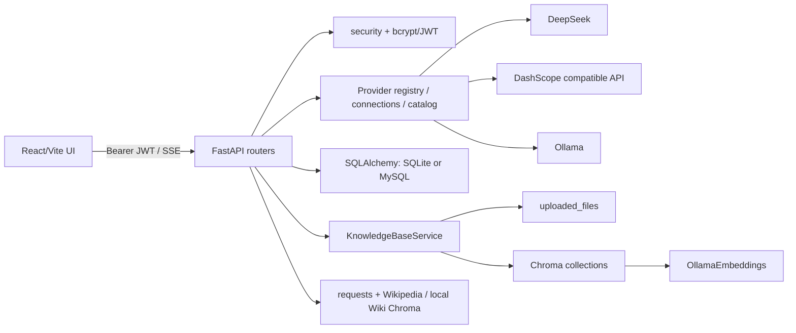

# OmniSage 项目工程审查报告

> 审查日期：2026-08-13（Asia/Shanghai）  
> 审查对象：工作区当前未提交状态（`develop`，基线提交 `3721c3b`）  
> 原则：除本报告外只读；未修改业务代码、配置、依赖、数据库、向量库或用户数据。

## 1. 执行摘要

OmniSage 已形成可运行的个人 AI 知识工作台：React 19 前端、FastAPI API、JWT 登录、连接级 Provider/模型目录、SSE 文本聊天、SQLite/MySQL 元数据、Chroma + Ollama 本地嵌入，以及在线/离线 Wiki。近期 Provider 重构的契约、凭证隔离和前端错误映射质量明显高于旧 RAG 模块；当前后端 38 项测试、前端 28 项测试、类型检查、lint、构建均通过，OpenAPI 快照与运行时代码一致。

但项目还不能视为生产就绪。最优先的五项工作是：

1. **SEC-001（P1）**：知识库名称直接参与目录拼接，`../../../../escape` 可逃逸 `uploaded_files`；删除知识库随后对该派生目录执行 `shutil.rmtree()`。
2. **BUG-001（P1）**：普通多轮聊天只把当前用户消息发送给 Provider；数据库历史仅用于 UI，不进入生成上下文。
3. **DATA-001（P1）**：文件、向量和 SQL 元数据跨三种存储分阶段写入/删除，无事务状态机或可靠补偿，失败可留下幽灵向量、孤儿文件或错误成功响应。
4. **PERF-001（P1）**：知识库解析/嵌入、Chroma 检索和 Wiki `requests` 都在同步 FastAPI 路由中执行；Wiki 多个请求没有超时，能够长期占用工作线程。
5. **DEPLOY-001（P1）**：容器发布闭环阻断：前端 Dockerfile 复制不存在的 `.npmrc`，后端 `uv.lock` 被 `.gitignore` 排除却被 Dockerfile 要求，Compose 必需 MySQL 变量不在示例配置中。

总体评分 **5.6/10**。其优势是 Provider 抽象、用户所有权校验、凭证加密与前端基本体验；短板集中在旧知识库域、真正多轮上下文、数据一致性、生产迁移/部署、可观测性和端到端真实集成测试。审查未发现已确认的 P0，但 SEC-001 在允许不可信用户注册或共享部署时具有越界删除风险，应按阶段 0 处理。

## 2. 项目现状与总体评分

| 维度 | 分数 | 依据 |
|---|---:|---|
| 架构 | 6.0 | 新 `app/ai` 分层清楚；旧 `knowledgebase_service.py`、`rag_chain_service.py`、`wiki_service.py` 体量大且混合 I/O、领域和基础设施。 |
| 功能完整性 | 6.0 | 认证、连接、目录、文本聊天、知识库基础闭环存在；无刷新令牌，Agent/多模态/在线 Embedding/Rerank 仅契约或未实现。 |
| 正确性 | 5.0 | 当前测试全绿；但多轮上下文缺失、跨存储不一致和删除匹配问题影响核心路径。 |
| 可维护性 | 5.5 | AI 契约类型较好；数据库服务大量吞异常，RAG 巨型模块、重复 `get_db`、大量 `print`。 |
| 可扩展性 | 6.0 | Provider registry/model descriptor 可扩展；知识库仍绑定 Ollama/Chroma，嵌入空间元数据不足。 |
| 安全性 | 4.5 | JWT、bcrypt、Fernet、所有权过滤和 Markdown 清洗良好；目录逃逸、无速率限制、弱注册策略和 Token 存储仍有风险。 |
| 性能稳定性 | 4.5 | 流式 Provider 使用异步 HTTP；RAG/Wiki 阻塞、客户端反复创建、无任务队列/限流/断路器。 |
| 测试 | 6.0 | 38 后端 + 28 前端 + 6 Playwright 场景；缺少路由级后端、真实前后端、知识库故障注入和覆盖率门禁。 |
| 可用性 | 6.5 | 空态、错误、停止生成、连接提示较完整；首次使用仍依赖手动 Ollama/目录刷新，引用二次检索可能与回答不一致。 |
| 前端视觉 | 6.5 | 风格统一且响应式基础良好；移动弹窗实测溢出，颜色硬编码多、无深色方案。 |
| 文档与运维 | 5.0 | README 诚实记录大量限制，OpenAPI 同步；Compose 不可构建、无 CI/Alembic/生产运行手册。 |

## 3. 系统架构与核心数据流

目标用户是希望统一管理本地/在线模型、个人文档和 RAG 问答的开发者或个人知识工作者。核心场景为“注册登录 → 配置 Provider → 刷新模型 → 创建知识库/上传文件 → 搜索或聊天”。默认前端为 `frontend/`；`frontend-legacy/` 是不再支持的 Gradio 历史实现。

核心实体生命周期：`User` 拥有 `Conversation`、`ProviderConnection`、`KnowledgeBase`；会话包含 `ChatMessage`；连接包含 `AIModelCache`；知识库包含 `KnowledgeFile`，但 Chunk/向量没有 SQL 实体。连接凭证使用 Fernet 密文；模型 key 为 `{provider}::{connection_id}::{model_id}`。会话/连接/知识库查询大多以 JWT 当前用户过滤。

聊天链路：UI 创建会话并提交 `NormalizedChatRequest` → 后端校验会话和模型所有权/能力 → 可选同步检索并把上下文加入请求 → Adapter 流式调用 Provider → SSE 返回 → 流结束后用新 Session 持久化。知识库链路：同步写文件 → 解析/切分 → Ollama 嵌入 → Chroma 写入 → SQL 写 `KnowledgeFile` 并重算计数。

配置从仓库根 `.env` 加载；默认 SQLite，相对数据目录取决于后端启动工作目录。日志为 Python 标准日志和残留 `print`，无 request ID、指标或 tracing。部署意图是 Nginx + FastAPI + MySQL + Ollama Compose，但目前不能构建。

## 4. 审查范围、方法和验证限制

已逐层读取入口、模型、Schema、路由、服务、Provider、RAG、前端路由/API/store/核心组件、测试、Docker、README、docs、CHANGELOG、迁移和任务记录；搜索了 TODO/占位/未实现、异常捕获、敏感字段、无界查询和硬编码样式。`TASK_PROGRESS.md` 是 2026-08-12 Provider 重构记录，仅作线索，当前命令结果优先。

限制：未使用真实 DeepSeek/百炼 Key，未发起付费推理；未要求 Ollama 或外部 Wiki 可用；未上传恶意真实文件；未执行数据库重置；无 Docker CLI，未构建镜像；未对 MySQL、并发负载、DNS rebinding、真实向量维度或模型权限做动态验证。E2E 使用 mock API，不代表真实前后端集成。

## 5. 关键发现总表

| ID | 严重度 | 置信度 | 摘要 | 工作量 |
|---|---|---|---|---|
| SEC-001 | P1 | Confirmed | 知识库名称可逃逸数据目录并影响递归删除目标 | S |
| BUG-001 | P1 | Confirmed | 聊天不向模型发送历史消息，不是真正多轮对话 | S |
| DATA-001 | P1 | Confirmed | 文件/Chroma/SQL 写删无原子性或可靠补偿 | M |
| PERF-001 | P1 | Confirmed | RAG/Wiki 阻塞 I/O 占用同步工作线程，部分请求无超时 | M |
| DEPLOY-001 | P1 | Confirmed | Docker/锁文件/示例环境变量构建链断裂 | S |
| DATA-002 | P2 | Confirmed | 删除向量使用原始文件名子串匹配，可能误删同名/包含名文档 | S |
| DB-001 | P2 | Confirmed | 无 Alembic，`create_all()` 不能升级既有 schema | L |
| SEC-002 | P2 | Risk | 无登录/注册/API 速率限制，公网部署可被暴力破解或耗尽模型额度 | M |
| AI-001 | P2 | Confirmed | 百炼模型类型会按名称家族启发式推断，文档“未知不猜测”与实现不一致 | S |
| RAG-001 | P2 | Confirmed | 嵌入空间仅存模型名，缺 provider/dimension/version/metric/index state | M |
| UX-001 | P2 | Confirmed | 390×844 下 Provider 弹窗高度 916px，底部不可达 | XS |
| RAG-002 | P2 | Confirmed | UI 在回答后再次检索引用，引用并非生成时上下文的可靠证据 | M |
| API-001 | P2 | Confirmed | 知识库 API 返回服务器绝对文件/向量路径 | XS |
| PERF-002 | P2 | Confirmed | 会话列表 N+1 统计、多个列表无服务端分页 | S |
| TEST-001 | P2 | Confirmed | 缺少真实路由集成、RAG 故障注入和 CI；移动 E2E 当前失败 | M |
| DOC-001 | P3 | Confirmed | README 百炼“需手填模型”与无白名单自动目录实现不一致 | XS |
| MAINT-001 | P3 | Confirmed | 旧 RAG 服务巨型、异常吞噬及 `print` 降低可诊断性 | M |

## 6. P0/P1 高优先级问题

### SEC-001：知识库名称可造成目录逃逸和越界递归删除

- **严重程度/置信度**：P1 / Confirmed；**影响**：本机文件、其他知识库、容器挂载数据。
- **证据**：`schemas.KnowledgeBaseCreate.name` 无路径约束（`backend/app/schemas.py:61-65`）；目录使用 `f"kb_{name}"`（`knowledgebase_service.py:79-83`），删除用相同派生路径执行 `shutil.rmtree`（538-556）。只读 `Path.resolve()` 验证 `../../../../escape` 解析到 `backend/escape`，已在基础上传目录之外。
- **复现**：认证后创建名称为 `../../../../escape` 的知识库，再删除；预期名称只作标签，实际目录目标可跨出数据根。未执行真实创建/删除。
- **根因**：把可变展示名同时当作存储标识，且删除前没有 `resolve().is_relative_to(base)` 防护。
- **修复**：路径只使用不可变 UUID/数据库 ID；名称 trim、长度和字符校验；所有删除统一通过 safe-path guard，拒绝根目录/工作区/越界目标；迁移旧目录。**验证**：参数化 `../`、反斜杠、绝对路径、Unicode 分隔符测试，确认目录始终位于用户根；临时目录中验证删除范围。**工作量** S；迁移既有路径需备份与回滚。

### BUG-001：已持久化会话历史未进入 Provider 上下文

- **严重程度/置信度**：P1 / Confirmed；**影响**：所有多轮聊天与 grounded chat。
- **证据**：前端每次仅构造一个 user message（`chat-workspace.tsx:238-247`）；后端直接把该 `req` 传给 Provider（`chat.py:47-57`），只在标题判断时读历史（44）；Adapter 仅遍历 `request.messages`。`DatabaseService.get_chat_history()` 未用于生成。
- **复现**：先问“记住数字 731”，再问“刚才的数字是什么”；预期回答 731，实际 Provider 看不到首轮（除非偶然猜中）。
- **根因**：重构把消息契约收窄为当前输入，却未在服务端装配历史。
- **修复**：服务端按会话所有权加载最近 N 轮，规范化为 ContentPart，再追加当前输入；明确 token budget、系统/RAG 上下文次序与 regenerate 语义，避免前端伪造历史。**验证**：Fake Provider 捕获完整 messages；覆盖首轮、多轮、截断、regenerate、跨用户。**工作量** S。

### DATA-001：知识库跨存储写删不一致

- **严重程度/置信度**：P1 / Confirmed；**影响**：上传、删除、统计、检索结果与磁盘空间。
- **证据**：上传依次写文件、Chroma、SQL（`knowledgebase_service.py:159-210`）；若 SQL 保存失败，只删物理文件，不删已写向量（218-233）。删除文件先删磁盘、向量失败仍继续删 SQL（597-619）。删除知识库先 `rmtree`，最后才软删 SQL（549-560）。
- **触发**：SQL commit/Chroma/文件权限在中途失败或进程崩溃。实际可出现幽灵向量、不可恢复文件丢失、SQL 仍 active 但目录已删。
- **根因**：缺少 ingest job/status、稳定 chunk ID、补偿日志和幂等操作。
- **修复**：SQL 先建立 `pending` 文档任务；上传至临时目录；以 `file_id/chunk_id` 写独立 collection；成功后原子切状态；删除先标 `deleting`，幂等清理后完成。失败进入 `failed` 可重试；定期 reconciliation。**验证**：在每个阶段注入异常并断言最终状态；重跑同一任务不重复向量。**工作量** M；需 schema 迁移。

### PERF-001：同步 RAG/Wiki 路径会阻塞并可能无限等待

- **严重程度/置信度**：P1 / Confirmed；**影响**：并发请求、SSE 首 token、服务可用性。
- **证据**：上传/检索路由是同步 `def`，内部执行解析、Ollama embedding、Chroma（`rag.py:164-197,249-300`；`knowledgebase_service.py:293-429`）。Wiki 使用 `requests.Session`；搜索、摘要、HTML、分类请求未设 timeout（`wiki_service.py:432,459,465,497`），一次搜索可串行产生 `1 + 3×N` 请求。grounded chat 在进入 async stream 前同步检索（`chat.py:42-43`）。
- **修复**：索引移至任务队列；短检索用受限线程池/async client；每个 HTTP 设置 connect/read/total timeout、并发上限与取消；生成前返回明确 retrieval 状态。**验证**：50 并发健康/聊天请求，故障 Wiki 不拖死线程池，客户端断开可取消。**工作量** M。

### DEPLOY-001：发布构建不可复现

- **严重程度/置信度**：P1 / Confirmed；**影响**：任何新环境和 CI/CD。
- **证据**：`frontend/Dockerfile:6` COPY 不存在的 `.npmrc`；`backend/Dockerfile:10-11` 要求 `uv.lock`，但 `.gitignore:35` 忽略且 `git ls-files` 无它；Compose 依赖四个 MySQL 变量，`.env.example` 未列出。Docker CLI 不存在，无法动态构建。
- **修复**：决定并提交锁文件策略；删除无需求 `.npmrc` COPY 或提交受控文件；补完整 compose 示例与 `docker compose config`/build CI；固定镜像 digest/版本。**验证**：干净 clone 上 compose build/up、health、注册、上传 smoke。**工作量** S。

## 7. Bug 与正确性问题

### DATA-002：文件向量删除可能误删

- **P2 / Confirmed**；证据 `knowledgebase_service.py:456-474` 用 `if original_filename in source_filename` 匹配，且打开 Chroma 时使用全局默认 embedding 而非知识库记录（431-444）。
- **复现**：上传 `a.txt` 与 `data.txt`，删除 `a.txt`；两者 source 均可能命中。预期仅删 file_id 的 chunks。
- **修复/验证**：入库时写 `file_id`、`chunk_id`，用 Chroma where 精确删除并校验删除数；同名和包含名回归测试。**工作量** S；旧向量需重建或元数据迁移。

### RAG-002：回答引用与生成上下文可能不一致

- **P2 / Confirmed**；后端 grounded retrieval 只拼文本，未发 citation SSE（`grounded_chat.py:14-37`）；前端流完成后再次调用搜索（`chat-workspace.tsx:286-300`）。数据、阈值、Wiki 排名或缓存变化会使展示引用不同于模型实际上下文。
- **修复**：检索结果形成稳定 citation IDs，在同一流先发 `citation` 事件，生成 prompt 引用 IDs；持久化引用快照。验证回答引用不触发第二次检索。**工作量** M。

### API-001：知识库响应泄露服务器路径

- **P2 / Confirmed**；`KnowledgeBaseResponse.vector_db_path`、`KnowledgeFileResponse.file_path`（`schemas.py:67-94`）被路由返回。虽需认证，但会暴露服务器目录结构且前端并不需要。
- **修复**：public schema 移除内部路径，仅返回 opaque ID；验证 OpenAPI 和 UI 无依赖。**工作量** XS，属于破坏性契约需同步类型。

### UX-001：移动端 Provider 弹窗超出视口

- **P2 / Confirmed**；`pnpm e2e` 在 390×844 得到弹窗底部 916；`provider-connections.tsx` 的 Dialog 未建立稳定 `max-height + overflow-y-auto` 容器。桌面 5 项通过。
- **修复**：使用 `inset-y-3 max-h-[calc(100dvh-24px)] overflow-y-auto`，footer sticky；在 320/390px 和软键盘视口测试。**工作量** XS。

### PERF-002：列表查询会随数据量退化

- **P2 / Confirmed**；会话先无界 `.all()`，再每项 `len(conv.messages)` 触发 N+1（`database_service.py:106-113`、`conversation.py:78-95`），`limit` 仅在 Python 切片；连接、模型、知识库、文件也有无界 `.all()`。
- **修复**：SQL count/group、cursor pagination、稳定排序与最大页；前端无限/分页查询。验证查询数恒定、10 万行 P95。**工作量** S。

## 8. 功能完整性矩阵

| 功能 | 前端入口 | API/服务/数据 | 测试 | 状态 |
|---|---|---|---|---|
| 注册/登录/恢复/退出 | Login、TopBar | `/auth/register|login|me`；JWT | 前端单测、mock E2E | 部分：无 refresh/revoke 服务端退出 |
| 会话 CRUD/历史 | Chat panel | `/conversations/*`；Conversation/Message | 删除 E2E、持久化单测 | 已实现；生成不使用历史（BUG-001） |
| Provider CRUD/测试 | Settings | `/ai/connections*`；Fernet | 服务/组件/E2E | 已实现；无真实凭据验证 |
| 模型目录/刷新/筛选 | Settings/Composer | ModelCatalog cache | Provider/服务单测 | 已实现；百炼分类有启发式 |
| 文本流式聊天 | Chat | `/chat/stream`；Adapters | SSE 单测/mock E2E | 部分：单轮上下文，持久化在流结束后 |
| reasoning | Composer/Message | capability + SSE | 单测 | 已实现，仅当能力确认 |
| grounded chat | Composer | local Chroma/Ollama + generation | 参数单测 | 部分：无同流引用、reranker 未接入 |
| 知识库 CRUD | Knowledge | `/rag/knowledge-bases` | 少量组件测试 | 部分：路径与一致性问题 |
| 上传/解析/切分/索引 | Knowledge Detail | 同步服务/Chroma | 文件前端校验 | 部分：无任务状态/失败恢复 |
| 知识库搜索 | Search | `/rag/.../search` | 结果组件测试 | 已实现；依赖 Ollama |
| Wiki 搜索/模式 | Search/Settings | requests/Chroma singleton | mock E2E 未覆盖真实服务 | 部分：阻塞、全局模式 |
| Agent/tools | Composer 枚举约束 | 无工具执行循环 | 契约测试 | 占位/不可用 |
| 多模态/图像/语音/视频 | 无 | 仅 Schema/Protocol | 契约测试 | 未实现/不可达 |
| 在线 Embedding/Rerank | 无 | 仅契约边界 | 无执行测试 | 未实现 |
| Docker 部署 | 无 UI | Compose/Dockerfile | 无 | 不可用 |

## 9. 已提及但未实现/未闭环功能

| 宣称/线索 | 实际状态与证据 | 缺失部分 | 建议 |
|---|---|---|---|
| Agent | `WorkflowType`/tools 校验存在；无执行循环 | tool registry、授权、审计、循环/预算 | UI 隐藏或标 Experimental |
| 多模态 ContentPart | Schema 有 image/audio/video/document | Asset 存储、所有权、Adapter 映射、UI | 先建 Asset 域再开放 |
| 在线 Embedding/Rerank | request/protocol 存在 | Provider 方法、路由、KB 配置/迁移 | 按第 14 节架构实施 |
| 本地 Reranker | 旧 `LangchainReranker` 存在 | grounded path 未调用，UI 参数无效 | 接入或移除误导参数 |
| Wiki 数据处理 | `process_wiki_data()` 无路由装饰器（`rag.py:509`） | 管理入口、权限、后台任务 | 仅保留 CLI 并文档化 |
| Refresh token | 用户要求核查；代码无实现 | token family、rotation/revoke | 若面向公网则实现 |
| Docker Compose | README 已注明不可用 | 构建输入、env、实际 smoke | 阶段 0 修复 |
| 自动 schema 升级 | 仅 `create_all()` | Alembic revision/upgrade | 阶段 2 建立 |

## 10. 项目结构与架构评估

`app/ai/contracts/providers/services/workflows/security` 是合理的扩展边界；运行时 connection snapshot 避免流生命周期持有 Detached ORM，测试也覆盖这一点。反面是三套 `get_db()`、路由直接调用静态数据库服务、服务内部自行 commit，难以建立事务边界。RAG 三个服务约 90KB，包含解析、模型、网络、下载、甚至运行时 `pip install wikiextractor`（`wiki_service.py:257-275`），职责严重混合。全局 `knowledge_base_service` 和进程内 Wiki 模式/cache 导致多 worker 状态不一致。

建议以领域切片拆为 Repository、ObjectStore、Parser、Chunker、EmbeddingBackend、VectorIndex、Retriever、IngestJob；路由只编排 use case，事务由 use case 控制。异步后台工作不持有请求 Session。

## 11. 可维护性评估

Pydantic AI 契约和 TypeScript OpenAPI 快照是强项。主要债务：`DatabaseService` 几乎每个方法捕获所有异常并返回 `None/[]/False`，调用者无法区分“无数据”和“数据库故障”；日志多无 exception/context；残留 `print`；时间同时使用 naive `datetime.now()` 和 UTC aware 后再去 tz；知识库内部访问 Chroma 私有 `_collection`。建议统一 typed domain errors、结构化日志和 Unit of Work，开启 Ruff/Pyright；把前端超长 Provider/Chat 组件拆为 hooks + form sections。

## 12. 可扩展性评估

新增 Chat Provider 主要实现 Adapter 并注册，扩展性良好；task/modality/capability metadata 也能 fail closed。但 Provider enum、地域模板和前端表单仍需共同修改。更严重的是 Embedding 虽有 Protocol，却未进入知识库执行链；向量库、解析器和 chunker 都在具体服务硬编码。模型槽位存在但未解析执行。应将 capability registry 与 connection form schema 由后端元数据驱动，并把知识库绑定到不可变 embedding profile + index generation。

## 13. AI Provider 与模型目录评估

DeepSeek 固定官方 base URL，动态 `/models`；Ollama 限本地/私网并从 `/api/show` 读取 runtime capabilities；百炼按地域构造受控端点、支持 workspace 和手工白名单。凭证加密、掩码、不回显、上游 401 映射为 424，设计正确。目录失败能回退同连接 stale cache。

问题：每次请求新建 `httpx.AsyncClient`，失去连接池复用；SSRF 校验只在配置时 DNS 解析，实际请求未绑定已校验 IP，存在 DNS rebinding 设计风险；百炼 `_model_profile()` 在缺少 metadata 时按名字推断任务（`dashscope/provider.py:29-47`），与架构文档“未知能力保持 null，不按名称猜测”冲突。应显式标注 `classification_source=heuristic`、confidence，并让未知默认不可执行。测试连接 `/models` 只证明凭据/端点，不能证明某模型有调用权限；UI 应明确区分。

## 14. RAG 与嵌入模型评估

当前固定本地 Ollama `nomic-embed-text`，chunk 512/overlap 128，支持 PDF/TXT/MD/DOC(X)，Chroma relevance threshold + dynamic margin。缺少 MIME/魔数检查、按语言/文档类型策略、稳定 chunk ID、批量/限流/成本、索引状态、混合检索、实际 rerank、离线评测和 prompt-injection 防护。向量表不在 SQL，无法审计维度和版本。

**阿里云百炼在线向量推荐架构**：可行，但不能简单把模型字符串替换为百炼 ID。新增 `EmbeddingProfile(provider_connection_id, model_id, model_revision, dimension, distance_metric, normalization, batch_limit)`；知识库创建时复制成不可变 `IndexGeneration`，向量 collection 命名包含 `kb_id + generation_id`。统一 `EmbeddingBackend.embed_documents/embed_query`，实现 Ollama 和 DashScope adapter，强制入库/查询使用同 profile；首次小批探测并校验维度。在线调用加入批大小、令牌/请求限流、指数退避、成本/延迟指标和敏感数据告知。换模型时建立新 generation → 全量重嵌入 → 验证覆盖率/维度 → 原子切 active → 延迟回收旧索引，绝不原地混写。

质量路线：先构造 50—200 条领域 query/judgment；记录 Recall@K、MRR/nDCG、无答案拒答、答案忠实度和 citation precision；再比较本地与百炼的质量、P95、费用。混合 BM25+vector 后做 RRF，最后可选 rerank；检索结果必须带 source/page/chunk ID，并用同流 citation 约束回答。

## 15. 数据库与数据一致性评估

所有权查询基本正确；连接—模型和会话—消息配置了 ORM cascade。但 SQLite 外键默认未显式 `PRAGMA foreign_keys=ON`，且多个 ForeignKey 未声明 DB `ondelete`; 用户/知识库关系缺 ORM delete cascade。知识库名称仅应用层查重，无 `(user_id,name)` 唯一约束，竞态可重复。软删会话保留消息是设计可接受但缺恢复/清理策略。无 Alembic、备份仅 SQLite 脚本；MySQL 兼容未运行验证。

建议添加迁移、唯一/索引/外键策略，所有时间使用 UTC aware，定义数据保留与 hard-delete job；为每次 ingest/delete 建幂等状态机与 reconcile 工具。

## 16. 安全与隐私评估

已确认正向控制：bcrypt 12 rounds；JWT 校验后重新查用户；会话/KB/连接按用户过滤；Fernet 密文与掩码；云端 endpoint HTTPS + 私网阻断；上传 basename 清理与 10MiB 流式硬限制；Markdown sanitize；Nginx 有 CSP、frame deny、nosniff。

主要问题除 SEC-001/API-001 外：无注册/登录/模型调用速率限制和账户锁定（SEC-002）；密码只要求非空；JWT 无 issuer/audience/jti、refresh/revoke，sessionStorage 降低持久 XSS 暴露但仍可被同页脚本读取；上传只按扩展名选解析器，未核验 MIME/魔数和解析沙箱；知识库内容直接注入 prompt，无 prompt-injection 分类、来源信任或跨知识库策略；运行时可执行 `pip install` 不应存在于服务进程。当前 `.env`/DB/log 未被 Git 跟踪，`.gitignore` 有覆盖，这是正向结果。

## 17. 性能、稳定性与可观测性评估

Provider SSE 使用 async、Nginx 关闭 buffering，且流闭包用新 Session 持久化，避免 request Session 脱离问题。缺口：客户端每次新建、无全局限流/熔断；客户端中断前已生成内容不持久化且无明确状态；健康检查只返回 `ok`，不区分 DB/Ollama；无 request ID、JSON logs、metrics、trace、错误聚合、token/cost 指标；模型目录 cache 无 refresh singleflight，并发刷新可抖动清空/重写。建议建立 `/health/live` 与 `/health/ready`、OpenTelemetry、Prometheus 指标、provider latency/error/token/cost、ingest queue depth 和 structured audit log。

## 18. 测试与质量保障评估

现有单测覆盖契约、Provider 映射、凭证、所有权、stale cache、grounded 参数、SSE parser 和主要组件。缺口：后端几乎无 `TestClient` 路由测试；E2E 完全 mock API；无真实 FastAPI+SQLite+FakeProvider 集成；知识库上传/删除/故障恢复无测试；无并发、取消、MySQL、迁移、SSRF rebinding、上传恶意样本、覆盖率门禁。仓库无 `.github` CI。移动 E2E 当前 1 失败。

## 19. 可用性与用户流程评估

连接表单保留失败输入、展示字段错误和密钥掩码；聊天可停止、重试、删除后回空态；知识库/搜索空态总体清楚。首次使用仍要求用户理解 Provider、刷新目录、Ollama embedding；无法在创建知识库前检测 embedding 是否安装。建议 Dashboard 提供逐步 onboarding checklist 和“诊断连接”页面。当前“测试连接/刷新模型/保存”语义需分别说明鉴权证据、目录发现和配置持久化。危险删除有确认，但后端无可恢复窗口。引用应来自同一次检索而非二次请求。

## 20. 前端视觉与设计系统评估

静态审查显示布局、圆角、卡片、状态组件和可访问标签整体一致；路由懒加载，390px 有专门测试。主要缺陷为 UX-001。颜色在数十个组件直接硬编码（如 `#eaf4f0/#101828/#f8faf9`），会造成主题漂移；仅全局少数 token，无深色主题。Chat chunk 190.76KB、主 chunk 458.85KB（构建输出，未压缩），尚可但需性能预算。建议把 semantic surface/status/focus token 统一，加入 axe、键盘、200% zoom、320px/动态视口和深色对比测试。

## 21. 开发体验、部署与文档评估

README 启动命令、限制和安全提醒较详细，OpenAPI 28 paths 与当前运行时完全相同。缺点：`uv.lock` 策略矛盾；Prettier script 存在但包未安装，`format:check` 失败；无 CI；无 Alembic；Docker 已知不可用；相对路径依赖启动 cwd；README 百炼状态称“模型 ID 需手填”，实现则在无 whitelist 时暴露远端候选。Windows 本地命令有说明，但 Linux/container 尚未 smoke。

## 22. 优化机会清单

| 项目 | 现状 → 目标 | 收益 | 代价/风险/依赖 | 实施与验收 |
|---|---|---|---|---|
| OPP-01 安全路径层 | 展示名拼路径 → ID 路径 + guard | 消除越界删除 | S；迁移旧目录 | 双写/迁移/切换；所有恶意路径测试通过 |
| OPP-02 多轮上下文 | 当前单消息 → 服务端历史装配/token budget | 核心聊天正确 | S；上下文成本上升 | FakeProvider 断言、P95 token 可控 |
| OPP-03 Ingest 状态机 | 同步三存储 → pending/ready/failed/deleting | 可恢复、一致 | M；需迁移/worker | 故障注入 100% 可重试，无孤儿 |
| OPP-04 统一 AI client | 每次新建 → 生命周期连接池 | 降延迟/socket | S；关闭生命周期 | P95 与连接数下降，取消无泄漏 |
| OPP-05 Provider metadata | 家族猜测 → source/confidence/override | 避免错路由 | S；目录 UI 变化 | unknown 不可执行，误分类测试 |
| OPP-06 Online embedding | 本地硬绑 → immutable profile/generation | 百炼可选、可迁移 | L；隐私/成本/限流 | 维度守卫、A/B 指标、原子切换 |
| OPP-07 检索质量 | vector only → hybrid+rereank+同流引用 | 准确/可信 | L；需评测集 | Recall@5、nDCG、citation precision 达门槛 |
| OPP-08 契约与 CI | 手工检查 → CI 生成 diff gate | 防回归 | S；CI runner | lint/type/test/build/OpenAPI/E2E 必过 |
| OPP-09 Observability | 文本日志 → request/trace/成本指标 | 快速定位/控费 | M；后端组件 | 关键路径 dashboard、SLO/告警 |
| OPP-10 Onboarding | 手动摸索 → readiness checklist | 提高首次成功率 | S；依赖诊断 API | 新用户 10 分钟内完成首次 RAG |
| OPP-11 设计 token | 硬编码色 → semantic tokens | 一致/深色/可访问 | S；视觉回归 | 无散落 hex（白名单除外），AA 对比 |
| OPP-12 数据生命周期 | 软删/无清理 → retention/audit/restore | 合规、节省存储 | M；产品策略 | 可恢复窗口、清理报告、备份演练 |

## 23. 分阶段改进路线图

### 阶段 0：立即止血（约 3—5 天）

目标：阻断安全/核心错误。任务：SEC-001 safe path + ID 目录、BUG-001 历史装配、DATA-002 精确 file_id 删除、DEPLOY-001 构建修复、UX-001。依赖：备份现有目录；风险是旧目录迁移。验收：恶意路径不能出根；多轮 FakeProvider 通过；干净 clone build；6/6 E2E。

### 阶段 1：稳定核心流程（约 2—3 周）

目标：认证、连接、聊天、知识库失败可恢复。任务：ingest/delete 状态机、超时/取消/限流、统一错误、同流 citations、真实 FastAPI+FakeProvider E2E、密码和登录限流。验收：各阶段故障注入无孤儿；核心 API P95/SLO 建立；引用与 prompt 快照一致。

### 阶段 2：工程治理（约 2—4 周）

目标：清晰领域和可迁移数据。任务：Alembic、Unit of Work、Repository、拆分 RAG 服务、OpenAPI diff gate、CI、Ruff/Pyright/Prettier。依赖阶段 1 schema。验收：空库/旧版本升级和回滚演练；PR 门禁全绿；核心路由覆盖率 ≥80%。

### 阶段 3：体验与性能（约 2—3 周）

目标：首次成功、并发稳定、可观测。任务：onboarding/readiness、任务进度 UI、连接池/批处理/分页、design tokens、metrics/traces/cost dashboard。验收：首次 RAG 中位时间 <10 分钟；50 并发下健康 P95 <200ms（本地目标）；无移动溢出；关键错误均有 request ID。

### 阶段 4：能力扩展（约 4—8+ 周）

目标：在线 embedding、hybrid/rerank 与更多任务。任务：EmbeddingProfile/IndexGeneration、DashScope embedding、评测集、BM25/RRF/rerank；随后才建 Asset 域与多模态。验收：索引维度永不混用；切模型不中断查询；质量指标相对基线显著提升且成本预算可见。

## 24. 建议新增的测试清单

1. 路径逃逸、符号链接、根目录和迁移路径测试。
2. 多轮上下文、token 截断、regenerate、跨用户历史测试。
3. 上传在文件/解析/embedding/Chroma/SQL 每阶段失败的补偿与幂等测试。
4. 同名、包含名文件精确向量删除；删除数核对。
5. FastAPI + 临时 SQLite + FakeProvider 的注册—连接—聊天—持久化集成。
6. JWT 过期、并发 401、暴力登录限流、token revoke（实现后）。
7. SSRF IPv4/IPv6、重定向、DNS rebinding、userinfo/端口测试。
8. MIME/魔数、压缩炸弹、恶意 PDF/DOC、编码边界测试。
9. Wiki/Ollama timeout、取消、线程池饱和与断路器测试。
10. SQLite/MySQL migration parity、外键/级联/唯一竞态测试。
11. OpenAPI 快照与 TypeScript 类型无 diff 门禁。
12. 320/390px、软键盘、200% zoom、axe、focus trap 视觉回归。
13. RAG 离线评测：Recall@K、MRR/nDCG、faithfulness、citation precision。

## 25. 已执行命令及结果

| 命令 | 结果 |
|---|---|
| `git status --short --branch`、`rg --files`、规则/文档读取 | 成功；确认大量用户既有未提交改动，无 AGENTS.md |
| `backend/.venv/Scripts/python.exe -m pytest backend/tests -q` | **38 passed**，7.82s |
| `python -m compileall -q backend/app backend/main.py backend/scripts` | exit 0 |
| `pnpm typecheck` | exit 0 |
| `pnpm lint` | exit 0 |
| `pnpm test` | **14 files / 28 tests passed** |
| `pnpm build` | exit 0；主 chunk 458.85KB，Chat chunk 190.76KB |
| `pnpm e2e` | **5 passed, 1 failed**；390px Provider 弹窗超高 |
| `pnpm format:check` | exit 1；`prettier` 未安装/不可执行，不是格式内容判定 |
| 运行时 `app.openapi()` 对比 `openapi.json` | 28 paths，完全相等 |
| `backend/scripts/inspect_database.py` | 读取成功，列出 7 张预期表 |
| `git ls-files`/`check-ignore` 敏感与锁文件检查 | 无 `.env/db/log/uploads/chroma` 被跟踪；`backend/uv.lock` 被忽略 |
| `docker --version` | 命令不存在，未验证容器构建 |
| `Path.resolve()` 恶意知识库名称只读验证 | `../../../../escape` 可解析到上传根之外 |

说明：测试产生的 `dist/test-results` 均为现有命令的常规构建/测试产物且被 Git 忽略；未改业务源文件。并行命令曾返回会话状态，均已单独重跑取得上表最终结果。

## 26. 待人工确认事项

1. 产品是否会允许不可信用户自助注册或暴露公网；这决定 SEC-001/限流的紧急程度，但不改变修复必要性。
2. 多轮历史的目标窗口、token 预算、系统提示和隐私保留策略。
3. 现有知识库目录是否已有名称含路径字符，迁移前需只读盘点与备份。
4. 删除语义是立即不可恢复，还是提供回收站/保留期。
5. 百炼 embedding 的地域、数据合规、预算、目标模型与维度；真实 Key 需在隔离测试环境验证。
6. 生产数据库最终选择 MySQL 还是 PostgreSQL，以及可接受停机窗口。
7. `.npmrc` 是否本应存在；`uv.lock` 是否应正式提交。
8. Wiki 模式应是全局管理员配置还是用户级偏好；当前为进程内全局状态。
9. README 中百炼“手填模型”与自动候选目录的产品口径应统一。
10. 是否需要保存 reasoning summary；当前完整 reasoning 不持久化，符合较安全默认。

---

结论：先完成阶段 0/1，不宜立即扩展多模态或在线嵌入。当前 Provider 重构是可保留的良好基础；后续工程价值最高的方向是修复路径与聊天语义、把知识库处理改造成可恢复状态机，并建立真实集成测试、迁移和可观测性闭环。

## 修复进展（2026-08-13）

用户已授权修复五项 P1。当前实现已完成：SEC-001 使用知识库 ID 目录及 root containment guard；BUG-001 由服务端装配可信历史并处理 regenerate；DATA-001 为上传/删除增加 SQL rollback、file quarantine、file_id chunk 标识和 Chroma snapshot compensation；PERF-001 为 RAG/Wiki 引入受限 worker、独立 Session 和统一 HTTP timeout；DEPLOY-001 移除 `.npmrc` 阻断、提交 `uv.lock` 并补 Compose 示例变量。详细验证结果以本轮最终回复和 `TASK_PROGRESS.md` 最新条目为准；Docker 因环境无 CLI 仍待外部 smoke test。
