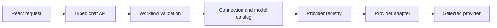
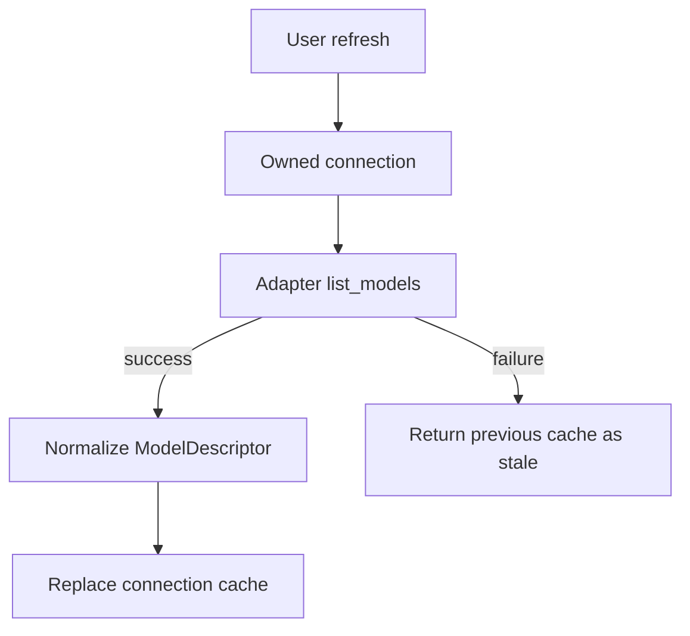
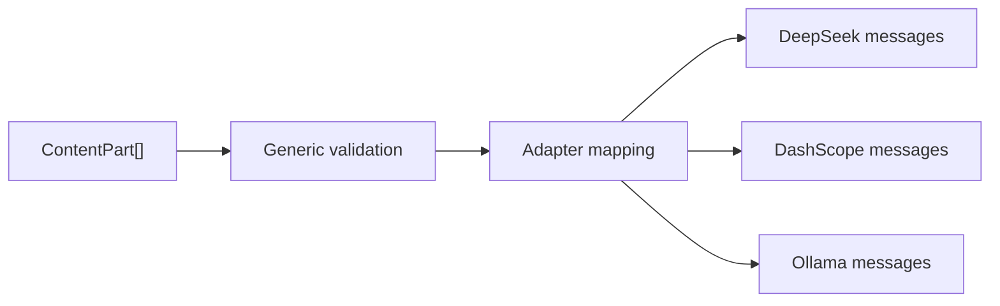
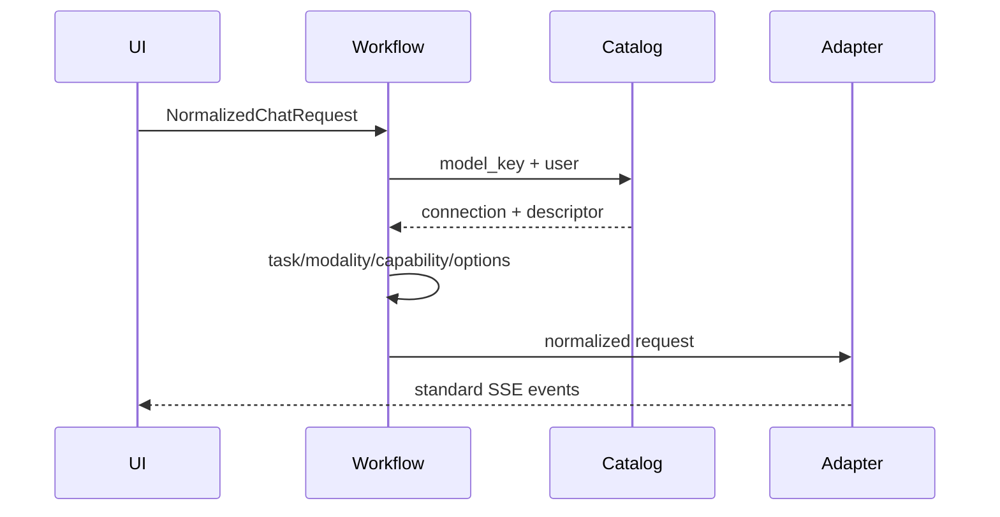
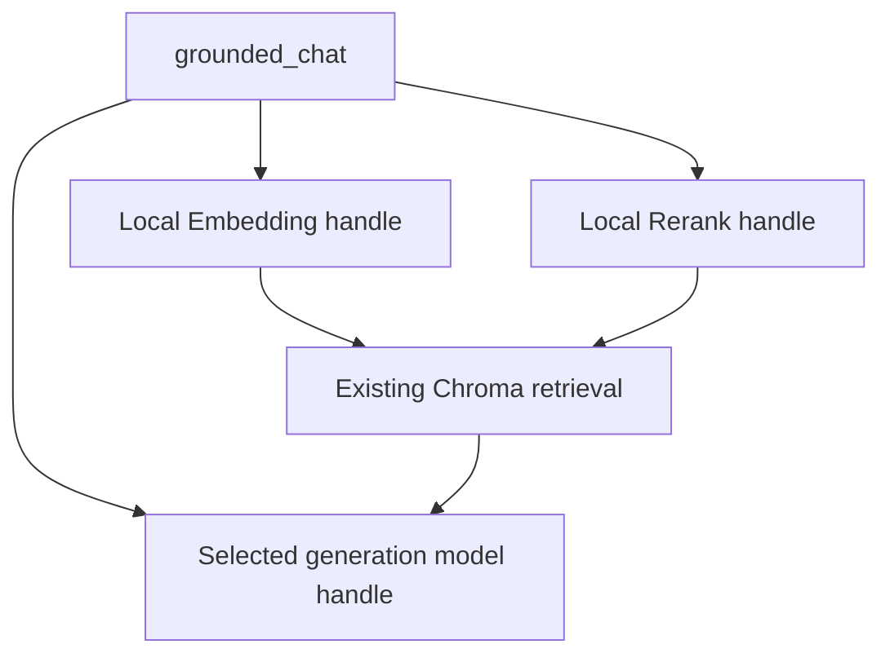

# AI Provider 架构

## 目标与边界

重构将 Provider（实现类型）、Connection（用户连接）、Model（连接下发现项）、Task、Modality、Capability 与 Workflow 分离。目标是连接隔离、动态目录、能力先验校验和统一事件；非目标是本阶段实现在线 Embedding/Rerank、TTS/STT、视觉或 Asset 上传。

## 契约

Adapter 提供 `test_connection`、`list_models`、`supports_task`；Chat Provider 另提供 `stream_chat`。ModelDescriptor key 是 `{provider}::{connection_id}::{model_id}`，含任务、输入/输出模态、nullable capabilities、limits、source、available、fetched_at 与 stale。未知能力保持 null，不由名称猜测；`vision` 仅由 image input modality 派生。

ContentPart 是带 discriminator 的 Text/Image/Audio/Video/Document/ToolResult 联合类型。当前 Adapter 完整映射 TextPart，其他 Part 经能力校验明确失败。

direct_chat 需要 Chat；grounded_chat 需要 Chat + 本地 Embedding，可选本地 Rerank；agent 需要 Chat + tools。模型槽位预留 generation/embedding/rerank/speech key。

Embedding 配置属于知识库而非单个文件。同一知识库的建库向量和查询向量必须使用同一个 Provider、模型、版本/别名与输出维度；更换任一项必须重建整个知识库索引，不能在同一个 Chroma collection 中混用不同嵌入空间。在线 Embedding Adapter 尚未接入现有知识库执行链路。

标准事件包括 content_delta、reasoning_delta、tool_call、tool_result、citation、media、usage、done、error；当前不会模拟 media。取消连接会取消上游 HTTP 流。

## 安全与扩展

连接归当前认证用户；凭证加密；云端自定义 URL 仅 HTTPS，解析 DNS 后拒绝私网、link-local 与元数据；Ollama 限本地/私网。错误在 Adapter 边界脱敏。新增 Provider 依照 [新增 Provider](adding-ai-provider.md)，新增任务依照 [新增任务](adding-ai-task.md)。

官方依据：[DeepSeek model list](https://api-docs.deepseek.com/api/list-models)、[DeepSeek chat](https://api-docs.deepseek.com/api/create-chat-completion)、[DeepSeek thinking](https://api-docs.deepseek.com/guides/thinking_mode)、[Model Studio overview](https://help.aliyun.com/zh/model-studio/what-is-model-studio)、[Model Studio Chat](https://help.aliyun.com/zh/model-studio/qwen-api-via-openai-chat-completions)、[Ollama list](https://docs.ollama.com/api/tags)。百炼地域 Key/Workspace/模型不可混用；compatible `/models` 结果作为候选目录展示并标记权限未验证，另允许 manual source 补充自定义模型。
