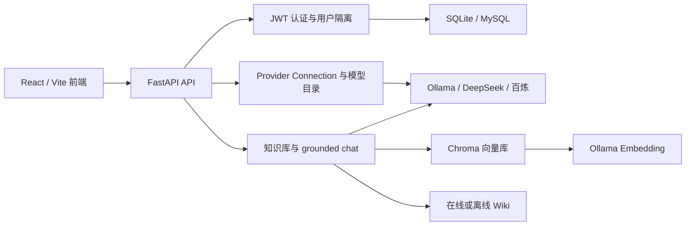

# OmniSage

OmniSage 是一个基于 FastAPI、React、Chroma 和可插拔 AI Provider 的个人知识库与流式问答工作台。

它面向需要统一管理本地模型、在线大模型连接、文档知识库和检索增强生成（RAG）的开发者。当前默认前端位于 `frontend/`；`frontend-legacy/` 仅保留迁移前的 Gradio 实现，不再是受支持的主入口。

## 快速开始

下面是启动 Web 界面和后端 API 的最短本地路径。基础页面可以在不连接付费模型的情况下运行；聊天需要配置至少一个 Provider，知识库向量化和检索需要 Ollama Embedding 模型。

### 1. 准备环境

需要：

- Python 3.11+
- [uv](https://docs.astral.sh/uv/)
- Node.js `20.19+` 或 `22.12+`
- pnpm `11.21.0`
- Ollama：使用知识库、离线 Wiki 或 Ollama 聊天时需要

### 2. 创建本地配置

在仓库根目录执行：

```powershell
Copy-Item .env.example .env
```

`.env.example` 中的密钥只是占位符。在录入真实 Provider API Key 前，应为 `JWT_SECRET_KEY` 和 `CREDENTIAL_ENCRYPTION_KEY` 配置独立的随机值。

可在本地生成随机值：

```powershell
cd backend
uv run python -c "import secrets; print(secrets.token_urlsafe(48))"
```

分别执行两次，将结果写入仓库根目录 `.env`。不要提交 `.env`。

### 3. 启动后端

打开一个 PowerShell 窗口：

```powershell
cd backend
uv sync --dev
uv run python scripts/create_tables.py
uv run uvicorn main:app --reload --host 127.0.0.1 --port 8000
```

访问：

- 健康检查：<http://127.0.0.1:8000/health>
- Swagger UI：<http://127.0.0.1:8000/docs>
- ReDoc：<http://127.0.0.1:8000/redoc>

后端启动时也会通过 SQLAlchemy `create_all()` 创建缺失的表，因此 `create_tables.py` 是显式初始化步骤，不是唯一建表入口。

### 4. 启动前端

打开另一个 PowerShell 窗口：

```powershell
cd frontend
pnpm install --frozen-lockfile
Copy-Item .env.example .env.local
pnpm dev
```

访问 <http://127.0.0.1:5173>，注册用户并登录。

如果 PowerShell 执行策略阻止运行 `pnpm.ps1`，可以把上述命令中的 `pnpm` 替换为 `pnpm.cmd`。

### 5. 配置模型

登录后进入“设置”页面：

1. 创建 Ollama、DeepSeek 或阿里云百炼连接。
2. 测试连接。
3. 刷新模型目录。
4. 返回聊天页面，选择已发现且支持文本 Chat 的模型。

系统不会提供默认在线模型，也不会自动调用付费 API。

## 项目定位与使用场景

OmniSage 当前适用于：

- 通过统一界面管理多个 AI Provider 连接。
- 使用 Ollama 本地模型或在线文本模型进行流式对话。
- 上传个人文档并建立独立的 Chroma 知识库。
- 通过本地 Ollama Embedding 完成知识库检索和 grounded chat。
- 搜索在线中文维基百科，或使用预先构建的离线 Wiki 向量库。
- 开发新的 Provider Adapter、AI Task 或 Workflow。

当前项目更接近开发者工作台，不包含多租户管理后台、计费、配额、审计日志或生产级数据库迁移体系。

## 功能状态

| 功能 | 状态 | 说明 |
| --- | --- | --- |
| 用户注册、登录、登录恢复 | 已实现 | bcrypt 密码哈希、JWT Bearer Token |
| 用户数据隔离 | 已实现 | 会话、知识库和 Provider 连接按当前 JWT 用户隔离 |
| 会话管理 | 已实现 | 创建、列表、重命名、删除、消息历史 |
| 文本流式聊天 | 已实现 | 标准化 SSE 事件，可停止生成 |
| Ollama Provider | 已实现 | 动态发现模型及 runtime capabilities |
| DeepSeek Provider | 已实现 | 使用官方 `/models` 动态发现模型 |
| 阿里云百炼 Provider | 已实现 | OpenAI-compatible 文本聊天；模型 ID 需要手工填写 |
| Provider 凭证管理 | 已实现 | 服务端加密存储，只返回掩码 |
| 知识库管理 | 已实现 | 创建、删除、文件上传、文件列表和统计 |
| 文档向量化与搜索 | 已实现 | Chroma + Ollama Embedding |
| grounded chat | 已实现 | 将知识库或 Wiki 检索内容注入所选生成模型 |
| Wiki 在线搜索 | 已实现 | 调用中文维基百科 API，需要网络 |
| Wiki 离线检索 | 部分实现 | 需要维护者自行准备和初始化离线向量数据 |
| 本地 Reranker | 部分实现 | 旧 RAG 服务含 CrossEncoder 实现，但当前 `grounded_chat` 路径未调用 |
| Agent | 部分实现 | 有工作流枚举和 tools capability 校验，无工具执行循环 |
| 多模态 ContentPart | 仅预留契约 | 当前 Provider 调用只完整支持文本 |
| 在线 Embedding/Rerank | 未实现 | 只有请求契约和扩展边界 |
| TTS/STT、图像与视频 | 未实现 | 无 Asset 服务、调用路由或前端入口 |
| Docker Compose | 当前不可直接使用 | 见“Docker 状态” |

## 技术栈

### 前端

- React 19、TypeScript
- Vite 7
- React Router
- TanStack Query
- Zustand
- React Hook Form、Zod
- Tailwind CSS 4、Radix UI
- Vitest、Testing Library、Playwright
- `openapi-typescript`

### 后端

- Python 3.11+
- FastAPI、Uvicorn
- Pydantic
- SQLAlchemy
- SQLite 或 MySQL/PyMySQL
- Chroma、LangChain
- Ollama Embeddings
- sentence-transformers / CrossEncoder
- bcrypt、python-jose、cryptography

### 部署配置

- MySQL 8.4
- Ollama
- Nginx
- Docker Compose

请注意：部署相关文件已经存在，但当前 Docker 前端镜像存在已知构建问题，不能视为可直接运行的发布方案。

## 系统架构



文本聊天流程：

1. 前端使用 JWT 创建或选择会话。
2. 前端从服务端模型目录选择 connection-scoped `model_key`。
3. 后端验证连接所有权、模型任务、输入模态和能力。
4. `direct_chat` 直接调用所选 Provider。
5. `grounded_chat` 先使用本地 Ollama Embedding 检索知识库或 Wiki，再把上下文注入请求。
6. Provider 输出被转换为标准 SSE 事件。
7. 最终回答写入 `chat_messages`；完整 reasoning 文本不写入会话历史。

模型 key 格式为：

```text
{provider}::{connection_id}::{provider_model_id}
```

## 目录结构

```text
OmniSage/
├─ backend/
│  ├─ app/
│  │  ├─ ai/                    # Provider、连接、模型目录、契约和 Workflow
│  │  ├─ routers/               # auth、chat、conversation、rag 路由
│  │  ├─ services/              # 数据库、知识库、RAG 和 Wiki 服务
│  │  ├─ utils/                 # 文本分割、标题增强、Reranker 等
│  │  ├─ config.py              # 后端配置
│  │  ├─ database.py            # SQLAlchemy 引擎与 Session
│  │  └─ models.py              # 数据表模型
│  ├─ scripts/                  # 建表、检查、Wiki 初始化和受控重置脚本
│  ├─ tests/                    # 后端测试
│  ├─ main.py                   # FastAPI 入口
│  ├─ pyproject.toml
│  └─ Dockerfile
├─ frontend/
│  ├─ src/
│  │  ├─ api/                   # API 客户端及生成的 OpenAPI 类型
│  │  ├─ features/              # auth、chat、knowledge、search、settings
│  │  ├─ layouts/
│  │  ├─ pages/
│  │  └─ stores/
│  ├─ tests/e2e/                # Playwright mock E2E
│  ├─ package.json
│  ├─ vite.config.ts
│  ├─ nginx.conf
│  └─ Dockerfile
├─ frontend-legacy/             # 迁移前 Gradio 前端，仅供历史参考
├─ docs/                        # 架构、API 和维护文档
├─ .env.example                 # 后端及 Compose 配置示例
├─ compose.yaml
├─ openapi.json                 # 当前 FastAPI OpenAPI 快照
└─ README.md
```

运行时数据默认位于：

```text
backend/omnisage.db
backend/uploaded_files/
backend/chroma_db/
backend/wiki_data/
```

这些相对路径以启动后端时的当前工作目录为基准。推荐从 `backend/` 目录启动后端。

## 环境变量

后端会从仓库根目录 `.env` 加载配置，且不会覆盖进程或容器中已经存在的同名环境变量。

### 后端变量

| 变量 | 默认值 | 说明 |
| --- | --- | --- |
| `DATABASE_URL` | `sqlite:///./omnisage.db` | SQLAlchemy 数据库 URL；当前配置支持 SQLite 和 MySQL |
| `APP_ENV` | `development` | 运行环境；`production` 会加强数据库重置保护 |
| `DATA_DIR` | `.` | 上传文件和普通知识库 Chroma 数据的根目录 |
| `OLLAMA_BASE_URL` | `http://localhost:11434` | Ollama 地址 |
| `EMBEDDING_MODEL` | `nomic-embed-text` | 新知识库默认使用的本地嵌入模型 |
| `JWT_SECRET_KEY` | 未设置时随机生成 | JWT 签名密钥；生产环境必须固定配置 |
| `SECRET_KEY` | 无 | 旧部署兼容变量，仅在没有 `JWT_SECRET_KEY` 时使用 |
| `ACCESS_TOKEN_EXPIRE_MINUTES` | `1440` | JWT 有效期，单位为分钟 |
| `CREDENTIAL_ENCRYPTION_KEY` | 无 | Provider API Key 的加密根密钥；在线连接必须配置 |
| `MODEL_CACHE_TTL_SECONDS` | `3600` | 模型目录缓存有效期，单位为秒 |
| `CORS_ALLOWED_ORIGINS` | `http://127.0.0.1:5173,http://localhost:5173` | 逗号分隔的允许来源 |
| `SQL_ECHO` | `false` | `1/true/yes/on` 时输出 SQLAlchemy SQL 日志 |
| `SEARCH_MIN_SCORE` | `0.35` | 知识库独立搜索的最低相关度 |
| `SEARCH_SCORE_MARGIN` | `0.18` | 相对最佳结果的动态阈值差 |
| `SEARCH_CANDIDATE_MULTIPLIER` | `3` | 搜索候选数相对 `top_k` 的倍数 |

`JWT_SECRET_KEY` 未配置时，后端会在每次进程启动时生成临时密钥。这只适合单进程本地开发，重启后现有 Token 将失效，多进程实例之间也无法共享登录状态。

### 前端变量

这些变量通常写入 `frontend/.env.local`：

| 变量 | 示例或默认行为 | 说明 |
| --- | --- | --- |
| `VITE_API_BASE_URL` | `http://127.0.0.1:8000` | 浏览器 API 基础地址；未设置且处于开发模式时使用 `/api` |
| `VITE_DEV_PROXY_TARGET` | `http://127.0.0.1:8000` | Vite `/api` 代理目标 |
| `VITE_REQUEST_TIMEOUT_MS` | `30000` | 普通 API 请求超时 |
| `VITE_UPLOAD_TIMEOUT_MS` | `180000` | 文件上传超时 |
| `VITE_CHAT_TIMEOUT_MS` | `120000` | 聊天请求超时 |
| `VITE_OPENAPI_URL` | 默认读取根目录 `openapi.json` | 仅供 `generate:api` 脚本选择 OpenAPI 来源 |

### Compose 变量

`compose.yaml` 还引用：

| 变量 | 是否必填 | 说明 |
| --- | --- | --- |
| `MYSQL_DATABASE` | 是 | MySQL 数据库名 |
| `MYSQL_USER` | 是 | MySQL 普通用户 |
| `MYSQL_PASSWORD` | 是 | MySQL 普通用户密码 |
| `MYSQL_ROOT_PASSWORD` | 是 | MySQL root 密码 |
| `JWT_SECRET_KEY` | 是 | 后端 JWT 密钥 |
| `CREDENTIAL_ENCRYPTION_KEY` | 是 | Provider 凭证加密密钥 |

当前根目录 `.env.example` 没有列出 MySQL 变量；使用 Compose 前需要维护者补充，但当前 Compose 仍受下文所述构建问题影响。

## 数据库初始化与迁移

### 当前数据库模型

SQLAlchemy 当前定义以下表：

- `users`
- `conversations`
- `chat_messages`
- `provider_connections`
- `ai_model_cache`
- `knowledge_bases`
- `knowledge_files`

### 初始化空数据库

从 `backend/` 执行：

```powershell
uv run python scripts/create_tables.py
```

也可以直接启动 FastAPI，启动导入阶段会调用 `Base.metadata.create_all()` 创建缺失表。

### 数据库支持范围

- 默认数据库：SQLite，文件为 `backend/omnisage.db`。
- Compose 数据库：MySQL 8.4，通过 PyMySQL 连接。
- PostgreSQL：当前没有驱动、部署配置或经过验证的支持。
- Alembic：未集成。
- 自动 Schema 升级：未实现。

旧版 `user_api_keys`、`chat_history` 和裸模型字符串无法可靠转换为新的 Provider Connection、ContentPart 和 connection-scoped model key，因此项目明确不执行自动迁移。

受控重置和备份规则见[数据库重置与迁移](docs/database-reset-and-migration.md)。先使用只读预览：

```powershell
uv run python scripts/reset_database.py --dry-run
```

不要在未验证备份的情况下执行实际重置。普通数据库重置仍会删除用户、会话、消息、Provider 连接和知识库元数据。

## 前后端分别启动

### 后端开发模式

```powershell
cd backend
uv sync --dev
uv run uvicorn main:app --reload --host 127.0.0.1 --port 8000
```

### 后端生产式启动

仓库提供的容器入口实际运行：

```powershell
cd backend
uv run uvicorn main:app --host 0.0.0.0 --port 8000
```

直接暴露到公网前，应配置反向代理、TLS、固定密钥、可信 CORS 来源以及数据库备份。

### 前端开发模式

```powershell
cd frontend
pnpm install --frozen-lockfile
pnpm dev
```

开发服务器监听 `127.0.0.1:5173`。

### 前端生产构建

```powershell
cd frontend
pnpm build
```

产物生成到 `frontend/dist/`。仓库包含用于容器部署的 Nginx 配置，但没有独立的非容器发布脚本。

## Docker 状态

仓库的 `compose.yaml` 定义了：

- MySQL 8.4
- Ollama
- FastAPI 后端：宿主机端口 `8000`
- Nginx 前端：宿主机端口 `7860`
- Ollama：宿主机端口 `11434`
- MySQL 与 Ollama 命名卷
- 上传、Chroma 和 Wiki 的宿主目录挂载

但当前版本不能作为已验证的 Docker 启动方式：

1. `frontend/Dockerfile` 执行 `COPY ... .npmrc ./`，仓库中不存在 `frontend/.npmrc`，前端镜像会在复制阶段失败。
2. Compose 将 Wiki 数据挂载到 `/data/wiki_data`，但 `WikiService` 当前使用相对路径 `wiki_data`，没有使用 `DATA_DIR`，容器中的实际访问路径不一致。
3. 当前环境没有 Docker CLI，因此没有完成镜像构建验证。

在上述问题修复并完成实际构建测试前，不建议执行 `docker compose up --build` 或把 Compose 描述为开箱即用。

## AI Provider 配置

Provider 连接在“设置”页面按当前用户管理。模型目录和连接是服务端状态，前端使用 TanStack Query 获取；API Key 不会写入前端偏好设置。

### Ollama

- 默认地址：`http://localhost:11434`
- 不需要 API Key。
- 自定义地址只允许 loopback 或私网地址。
- 模型通过 `/api/tags` 发现。
- 任务和能力通过 `/api/show` 返回的 runtime capabilities 判断。
- 当前可执行能力以文本 Chat 为主；Embedding 用于本地知识库。

知识库默认要求：

```powershell
ollama pull nomic-embed-text
```

使用 Ollama 聊天时，还需要安装至少一个带 Chat 能力的模型，然后在设置页创建 Ollama 连接并刷新目录。

### DeepSeek

- 固定使用官方基础地址 `https://api.deepseek.com`。
- 必须提供 API Key。
- 模型通过官方 `/models` 动态发现。
- 支持标准流式文本聊天。
- Reasoning 选项会在模型目录明确声明相应能力时启用。

### 阿里云百炼

使用 OpenAI-compatible 文本聊天接口，必须提供 API Key 和地域。

| 地域 | Workspace |
| --- | --- |
| `cn-beijing` | 可选 |
| `ap-southeast-1` | 可选 |
| `us-east-1` | 不使用 |
| `ap-northeast-1` | 必填 |
| `eu-central-1` | 必填 |

百炼 compatible inference 接口不被项目视为可信的 per-credential 模型目录，因此：

- 可调用模型 ID 由用户通过 `manual_models` 明确填写。
- 模型能力通过 `manual_model_capabilities` 显式声明。
- 未声明的能力保持未知，不根据模型名称猜测。

### 凭证加密与轮换

Provider API Key 使用从 `CREDENTIAL_ENCRYPTION_KEY` 派生的 Fernet key 加密。API 响应只返回：

- 是否存在凭证
- 掩码
- 凭证版本

响应不会返回明文或数据库中的密文。

不要直接替换 `CREDENTIAL_ENCRYPTION_KEY` 后重启：旧凭证将无法解密。轮换根密钥时，需要先保留旧密钥解密，并逐条使用新密钥重新保存连接凭证。

## RAG 与知识库

### 创建知识库

1. 确认 Ollama 正在运行。
2. 确认 `EMBEDDING_MODEL` 对应模型已安装。
3. 登录 OmniSage。
4. 进入“知识库”页面。
5. 创建知识库。
6. 上传文档。

创建知识库本身不会验证 Embedding 模型；上传和搜索时才会调用 Ollama。

### 支持的文件

| 格式 | 扩展名 |
| --- | --- |
| PDF | `.pdf` |
| 纯文本 | `.txt` |
| Markdown | `.md` |
| Word | `.doc`、`.docx` |

单个文件最大 `10 MiB`。后端会清理上传文件名中的路径部分，但主要依据扩展名选择解析器，并未实现完整的 MIME/文件签名验证。

默认文本切分参数：

- Chunk size：512
- Chunk overlap：128

文件上传后会立即解析、切分并写入独立的 Chroma 目录。没有后台任务队列；较大的文档会占用当前请求。

### 知识库搜索

搜索使用：

1. Ollama Embedding 对查询向量化。
2. Chroma 相似度检索。
3. `SEARCH_MIN_SCORE`、`SEARCH_SCORE_MARGIN` 和候选倍数进行动态过滤。
4. 返回结构化引用结果。

### grounded chat

聊天页面选择“知识库问答”后：

1. 从指定知识库或 Wiki 检索文本。
2. 把检索结果作为 system message 插入请求。
3. 使用用户选择的生成模型回答。
4. 未检索到资料时，提示模型明确说明资料不足。

当前请求中虽然包含 `use_reranker`、Embedding/Rerank model slots，但此聊天路径仍直接使用 Chroma 检索结果，没有调用本地 CrossEncoder，也没有调用在线 Embedding/Rerank Provider。

## Wiki

Wiki 服务支持：

- 在线模式：访问中文维基百科 REST/Search API。
- 离线模式：使用 `wiki_data/wiki_vectors` 下的 Chroma collection。
- 自动模式：优先尝试在线 Wiki，失败后尝试本地数据；本地数据也不可用时仍回到在线模式。

设置页面可以查看状态并切换在线/离线模式。离线模式只有在向量库中已经存在数据时才可用。

仓库提供：

```powershell
cd backend
uv run python scripts/init_wiki_data.py --jsonl-path wiki_data/clean_corpus.jsonl
```

但仓库没有附带 `clean_corpus.jsonl`，该脚本也没有纳入当前自动化测试，并且 Wiki 路径尚未统一使用 `DATA_DIR`。因此它应视为维护辅助脚本，而不是已经验证的一键初始化流程。

仓库根目录的示例文本文件不会被自动索引；如需使用，应通过知识库页面上传。

## API 文档

后端运行后可访问：

- Swagger UI：<http://127.0.0.1:8000/docs>
- ReDoc：<http://127.0.0.1:8000/redoc>
- OpenAPI JSON：<http://127.0.0.1:8000/openapi.json>
- 仓库快照：[openapi.json](openapi.json)

当前仓库快照与 FastAPI 运行时 Schema 一致。

除注册、登录和健康检查外，业务路由均要求：

```http
Authorization: Bearer <access-token>
```

主要路由组：

| 前缀 | 用途 |
| --- | --- |
| `/auth` | 注册、登录和当前用户 |
| `/conversations` | 会话及消息历史 |
| `/chat/stream` | 标准 SSE 聊天 |
| `/ai` | Provider、连接和模型目录 |
| `/rag` | 知识库、检索和 Wiki |
| `/health` | 健康检查 |

详细 AI 请求、事件和错误结构见 [AI API](docs/ai-api.md)。

修改后端 Schema 后，可重新生成前端类型：

```powershell
cd frontend
pnpm generate:api
```

默认从仓库根目录 `openapi.json` 生成 `frontend/src/api/schema.d.ts`。该命令不会自动从正在运行的后端更新根目录 OpenAPI 快照。

## 测试与质量检查

### 后端

```powershell
cd backend
uv run pytest -q
uv run python -m compileall -q app scripts tests
uv run python scripts/reset_database.py --dry-run
```

本次审计结果：

- Pytest：`32 passed`
- Python compileall：通过
- 数据库 reset dry-run：通过

后端测试使用临时 SQLite 和本地 mock Provider，不调用真实付费模型。

### 前端

```powershell
cd frontend
pnpm generate:api
pnpm typecheck
pnpm lint
pnpm test
pnpm build
pnpm e2e
pnpm format:check
```

本次审计结果：

- OpenAPI 类型生成：通过
- TypeScript：通过
- ESLint：通过
- Vitest：14 个测试文件、25 项测试通过
- 生产构建：通过
- Playwright：5 项通过，包括 390px 移动端检查
- Prettier `format:check`：未通过，当前有 15 个文件存在格式差异

Playwright E2E 使用本地 mock API，不需要启动真实后端或调用模型。配置要求系统中存在 Chrome channel。

`pnpm test:coverage` 已定义，但项目没有声明 Vitest coverage provider，不能保证该命令在干净环境可直接运行。

## 常见问题

### 后端启动后登录立即失效

检查是否配置了固定的 `JWT_SECRET_KEY`。未配置时，每次后端进程启动都会生成新的临时密钥。

### 在线 Provider 连接创建失败

检查：

- `CREDENTIAL_ENCRYPTION_KEY` 是否已配置。
- API Key 是否至少 8 个字符。
- DeepSeek/百炼 Key 是否属于正确账户和地域。
- 百炼 Workspace ID 与地域是否匹配。
- 自定义云端地址是否为 HTTPS 且可正常解析。

### 设置中没有可选模型

创建 Provider 连接后，需要测试并刷新模型目录：

- Ollama：确认已有本地模型，且 `/api/tags` 和 `/api/show` 可访问。
- DeepSeek：确认 API Key 可以访问 `/models`。
- 百炼：手工填写已确认可调用的模型 ID。

刷新失败但存在旧缓存时，服务端会返回旧目录并标记为 stale。

### 文档上传或知识库搜索失败

检查：

- Ollama 是否运行在 `OLLAMA_BASE_URL`。
- `EMBEDDING_MODEL` 是否已经安装。
- 文件是否属于支持格式。
- 文件是否超过 10 MiB。
- `uploaded_files` 和 `chroma_db` 是否可写。
- 上传时使用的 Embedding 模型是否仍然可用。

### Wiki 离线模式无法启用

只有 `wiki_data/wiki_vectors` 中存在非空的 `wiki_articles` collection 时，离线模式才可用。仓库不附带 Wiki 语料或已构建索引。

### PowerShell 无法执行 pnpm

如果看到 `pnpm.ps1` 被执行策略阻止，可使用：

```powershell
pnpm.cmd install --frozen-lockfile
pnpm.cmd dev
```

也可以按组织安全策略调整 PowerShell Execution Policy。

### Docker 构建失败并提示 `.npmrc` 不存在

这是当前 `frontend/Dockerfile` 的已知问题，不是本地配置遗漏。需要先修改 Dockerfile 或将项目实际需要的 `.npmrc` 纳入仓库，再验证 Compose。

## 安全注意事项

- 不要提交 `.env`、API Key、Token、数据库密码或凭证加密根密钥。
- 生产环境必须固定配置独立的 `JWT_SECRET_KEY` 和 `CREDENTIAL_ENCRYPTION_KEY`。
- 不要直接轮换 `CREDENTIAL_ENCRYPTION_KEY`，否则已有 Provider 凭证不可恢复。
- Provider API Key 只应通过设置页面或受保护 API 提交。
- 云端自定义 Base URL 必须使用 HTTPS；后端会解析 DNS 并拒绝私网、loopback、link-local 和元数据地址。
- Ollama 自定义地址只允许 loopback 或私网。
- CORS 应只列出实际前端来源。
- 注册接口当前公开，项目没有管理员审批、验证码或注册开关。
- 当前没有登录限流、Provider 请求配额或通用应用级速率限制。
- 前端 JWT 保存在 `sessionStorage`；虽然渲染 Markdown 时使用了清洗器，仍应为部署配置 CSP 和 TLS。
- 上传文件主要依据扩展名识别，没有完整 MIME、恶意文档或内容安全扫描。
- 数据库重置和带 `--include-*` 的操作可能不可恢复；执行前阅读迁移文档并验证备份。
- 不要将 FastAPI 开发服务器直接暴露到公网。

## 当前限制与未实现功能

- 没有 Alembic 或自动数据库迁移。
- 旧数据库结构不能自动迁移到当前 Provider/消息模型。
- PostgreSQL 未配置或验证。
- Docker Compose 当前不能直接成功构建。
- Wiki 数据路径没有完整遵循 `DATA_DIR`。
- Wiki 离线数据不随仓库提供，初始化流程未纳入测试。
- 在线 Embedding、在线 Rerank 未实现。
- 当前 grounded chat 没有实际执行 Reranker。
- Agent 没有工具注册、工具执行或多步循环。
- 多模态 ContentPart 只有契约，Provider 路径只支持文本调用。
- TTS、STT、图片生成、视觉理解、视频理解和 Asset 服务未实现。
- 没有图片、音频或视频上传入口。
- 推理内容只在当前流中展示，不持久化完整 reasoning 文本。
- 文件解析、向量化和大型 Wiki 处理没有后台任务队列。
- 没有生产级可观测性、审计日志、限流或配额系统。
- Prettier 检查当前不通过。
- `frontend-legacy/` 不兼容新的 Provider 架构，也不保证可运行。

## 与旧文档的关键差异

当前实现以代码、配置和 `openapi.json` 为准：

- 默认前端已经从 Gradio 迁移到 React/Vite。
- 旧 `/models` 和 `/api-keys/*` 已删除，替换为 `/ai/providers`、`/ai/connections` 和 `/ai/models`。
- 聊天请求使用 connection-scoped `model_key`、ContentPart、Workflow 和标准 SSE 事件。
- 当前测试数量为后端 32 项、前端 25 项，而不是旧 README 中的 28/22。
- 当前 grounded chat 没有实际使用 Reranker。
- Docker 配置存在阻断构建的问题，不能按旧 README 描述为可直接启动。
- `frontend-legacy/README.md` 宣称 MIT License 并引用两个不存在的文档；仓库根 `LICENSE` 实际为 GNU AGPL v3。

## 相关文档

- [AI Provider 架构](docs/ai-provider-architecture.md)
- [AI API](docs/ai-api.md)
- [新增 AI Provider](docs/adding-ai-provider.md)
- [新增 AI Task](docs/adding-ai-task.md)
- [数据库重置与迁移](docs/database-reset-and-migration.md)
- [前端迁移说明](FRONTEND_MIGRATION_PLAN.md)
- [后端说明](backend/README.md)
- [前端说明](frontend/README.md)
- [Legacy 前端说明](frontend-legacy/LEGACY.md)
- [变更记录](CHANGELOG.md)
- [OpenAPI 快照](openapi.json)

## License

本项目根目录 [LICENSE](LICENSE) 为 GNU Affero General Public License v3.0。

## 待维护者确认

- 正式的源码仓库 URL、Issue Tracker、维护者联系方式和贡献流程。
- 当前版本应标记为 `0.1.0`、`1.0.0`，还是其他发布版本；后端包版本与 FastAPI API 版本目前不一致。
- 是否计划正式支持 PostgreSQL。
- Docker 前端缺失 `.npmrc` 是应删除复制指令，还是有文件尚未纳入仓库。
- Wiki 数据应统一放在 `DATA_DIR/wiki_data`，还是继续使用工作目录下的 `wiki_data`。
- 离线 Wiki 所需 JSONL 的正式来源、格式、许可、推荐规模和初始化流程。
- 是否计划让 grounded chat 真正启用本地 Reranker。
- 生产部署是否有尚未入库的反向代理、TLS、备份和密钥管理方案。
- `frontend-legacy/` 是计划长期保留，还是后续版本删除。
- 是否需要增加注册开关、登录限流、上传内容扫描和审计日志。
